# Structom

Structom (short for structured atoms) is a general-purpose data exchange format designed for universal applications.

Structom achieves its universality by providing rich, expressive data representation constructs that are highly efficient, lightweight, and bidirectionally compatible.

This document is the language specification for Structom. It covers the full feature set, from data layout to rich types.

### Feature set

- An expressive object notation designed for ergonomic, human-readable data files.
- An efficient binary encoding designed for bare-metal serialization performance.
- A rich schema system with a [module system](#imports) and forward and backward compatibility.
- A schemaless mode with full feature support in both the object notation and the binary encoding.
- Rich modeling constructs: [tagged unions](#unions), [tagged types](#tagged-struct), [tree structs](#tree-struct), [generics](#generics), [anonymous items](#inner-definitions), and more.
- Zero-copy binary decoding with support for segment based streaming and out-of-order decoding.
- A wide set of rich data types: [instance](#inst), [duration](#dur), [UUID](#uuid), [bigint](#bint) [bitfield](#bitfield), and more.
- Erasable [metadata](#metadata) for better tooling, with a set of common built-in metadata.
- many optional extensions implementations can opt to.

# Foundations

## Object notation

The object notation is Structom's human-readable, [JSON](https://www.json.org)-like format. It is designed for expressive data files edited by humans.

```structom
#!import_rich([color])
import "./schema.stomd"
Root {
	// comment
	a: "hello world",
	#metadata
	b: 123.456_789,
	c: [true, color "#ff8800", 0x"ab cd ff"],
}
```

The [gramex](https://docs.rs/gramex/latest/gramex/gram_ref/) metasyntax is used here to define syntax.

The object notation uses [UTF-8](https://en.wikipedia.org/wiki/UTF-8) encoding. A leading [`BYTE ORDER MARK (U+FEFF)`](https://en.wikipedia.org/wiki/Byte_order_mark#UTF-8) is removed.

Whitespace is insignificant and is only used to separate tokens.

```gramex
let ws = (' ' | '\t' | '\n' | '\r')*;
```

Identifiers are case-sensitive names for types, fields, namespaces, variants, and metadata.

`keywords` are reserved by the language and forbidden as user-defined identifiers. `weak_keywords` are reserved only in the specific contexts defined by the grammar.

```gramex
let ident_start = 'a'..'z' | 'A'..'Z' | '_';
let ident = ident_start (ident_start | '0'..'9')* & !keywords;
let keywords = "struct" | "union" | "true" | "false" | "none" | "inf" | "nan";
let weak_keywords = "import" | "as" | "fixed";
```

`list` is a grammar construct that specifies a `,`-separated list of items with an optional trailing `,`.

```gramex
let list<item> = item (',' item)* ','?;
```

### Comments

Comments are ignored and follow the C style: line comments (`//`) and block comments (`/* ... */`). Block comments can nest.

In addition, unit comments (`/-`) comment out the entire item that follows them. The item can be an item definition (struct or union), an import, metadata, a type, or a value.

Unit comments can also comment out array items, map items, fields, and generic parameters, along with the `,` that follows them, if present.

#### Example

```gramex
let line_comment = "//" !'\n'* '\n'?;
let block_comment = "/*" (block_comment | !"*/")* "*/";
let unit_comments = "/-" /* context defined unit */;
```

```structom
/* block comment
	/* nested comment */
*/
struct Struct {
	// line comment
	/- field1: u8,
	field1: str,
}
```

### Root structure

An object file starts with zero or more [imports](#imports), optionally followed by root [metadatas](#metadata) then local [item declarations](#items), and ends with a root value.

Values are constructs that represent data. They have multiple syntaxes depending on their types.

A value's type is inferred by default, but it can be specified explicitly when needed.

```gramex
let file = root_metadata* import* item* root_value:value;
let value = type?:type_spec /* see the value type for the syntax */;
```

#### Example

```structom
#!version("0.1.2")
#!import_rich([inst])

import "./schema.stomd"
import "../extensions.stomd" as ext

struct Tagged (u32)

Root {
	a: 123,
	b: inst "2022-01-01T00:00:00Z",
	c: Tagged 3,
}
```

## Binary encoding

The binary encoding is Structom's machine-friendly format, designed for high-performance serialization.

A binary file is interpreted as a sequence of bytes in which data is laid out in nested fields.

Data is encoded in little-endian byte order, aligned to its natural alignment, with some additional padding between fields.

### Core field types

Data is encoded as signed or unsigned integers of `n` bits, specified by the `u`/`i` field types.

Array-like data is encoded as a field holding the length followed by the items fields, through a pointer or inlined. Arrays are always `0`-indexed.

Pointers are `u32` fields that encode forward byte offsets relative to the pointer's own position. They point to objects in the current segment.

Null pointers are encoded with the value `0`.

#### Example

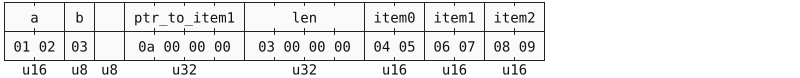

### Header

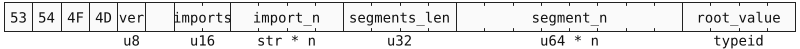

A binary file starts with a header that specifies its core attributes. The header is required for standalone files but optional for inlined blobs.

The header begins with the magic number `53 54 4F 4D` (`STOM`) followed by a `u8` `version` field, it is `1` in this version, then a pad byte.

It is followed by a list of imports encoded as a `u16` length field followed by the inlined `str`s encoding the import paths.

Next comes a list of segments encoded as a non-zero `u32` length field followed by the `u64` segment offsets scaled by 4 bytes.

If `segments_len` is `1`, no offsets need to be specified.

Finally, a `typeid` of the root value follows.

#### Example

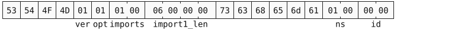

A header with 1 import (`"schema"`), 1 segment, and the root value `import("schema").first_type`.

### Segments

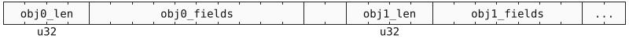

Segments are non-uniformly sized parts of a binary file.

They create a two-level address space for the file, which keeps pointers short (`u32`) while still supporting `u64` file sizes.

A segment is composed of multiple objects, each encoding a specific data structure defined by the schema.

Objects are aligned to `u64` boundaries and usually start with a `u32` field encoding the object's full size scaled by 4 bytes.

An object whose size is fixed in time does not need the size field, like boxed fixed structs in generic fields.

The root value is the first object in the first segment. Parent objects always come before their children.

There are at most `4.2 billion (2 ^ 32 - 1)` segments spanning at most `16GB (2 ^ 34)` bytes each, giving a theoretical maximum of `64EB (2 ^ 66 - 2 ^ 34)` file size.

# Declarations

Declarations are object notation constructs that act as schemas and define the shape of data structures.

They are written above the root value in object files, or in dedicated files called declaration files.

Local declarations can refer to each other in any order, not only to items above them.

Local declerations can shadow imported items and builtins, but can shadow namespaces.

#### Example

```structom
import "./module1.stomd"

struct Root {
	a: u8,
	b: Union,
	c: struct {
		e: i32,
		f: str,
	},
}

union Union {
	A, B, C,
	D(u64),
	E { v?: list<uuid> },
}
```

## Imports

```gramex
let import = "import" path:str ("as" ns:ident)?;
```

Imports bring the declarations of another declaration file into scope.

They are written with the `import` keyword followed by a `str` containing the URL, file-system path or user defined id of the declaration file.

If a namespace identifier (`ns`) is specified, the imported declarations are brought into their own namespace.

Imports cannot be circular.

#### Example

```structom
// module1.stomd
struct Struct { }

// module2.stomd
import "./module1.stomd"
union Union { }

// module3.stomd
import "./module1.stomd"
import "./module2.stomd" as mod2

struct Root {
	a: Struct,
	b: mod2.Union,
}
```

---

In the binary encoding, imports are encoded as a list inside the [header](#header). A namespace id is the import's index in that array plus 1.

## Type

### Type specifier

```gramex
let type_spec = (ns:ident '.')? item:ident ('<' params:list<type_spec> '>')?
	| inner_def // only in declarations
;
```

Type specifiers are object notation constructs that resolve to types. They are used wherever a type is expected.

In its basic form, a type specifier is the identifier of the type, resolved in the current scope.

A namespace identifier can be specified at the beginning, in which case the type is resolved from that namespace.

If the type is generic, its parameters are specified as type specifiers in a `,`-separated list enclosed in angle brackets.

In declarations, a type specifier can also be an [inner definition](#inner-definitions).

#### Example

```structom
import "./module1.stomd" as mod1
struct Local { }
union Generic<A, B, C> { }

struct Root {
	a: Local,
	b: mod1.External,
	c: Generic<u8, str, list<f64>>,
}
```

### Type identifiers


Type identifiers are fields in the binary encoding that specify the type of a value.

A type identifier is composed of two `u16` fields: a namespace identifier `ns`, and the type `id` within that namespace.

`ns` `0` is the built-in types namespace. The remaining values are assigned to imported files, using their index in the header's `import` array plus 1.

If the resolved item is [generic](#generics), its parameters follow the base `typeid` as additional `typeid`s.

#### Example


```structom
// module1.stomd
struct Struct { }
union Union<T> { A(T) }

// value.stomo
import "./module1.stomd"
[u8 10, Union<u8>.A 1]
```

## Generics

Generics generalize an item by parameterizing the types of some of its fields.

### Object notation

```gramex
let generic_params = '<' list<ident> '>';
```

An item becomes generic by specifying a set of generic parameters after its name in the definition.

These parameters are used like regular types in [type specifiers](#type-specifier), by name.

Type specifiers specify the parameters of a generic item with an angle-bracket list after the item path.

#### Example

```structom
struct Generic<A, C> {
	a: A,
	b: u16,
	c: arr<C, 2>,
}

Generic<str, u8> {
	a: "abc",
	b: 1234,
	c: 0x"00 ff",
}
```

### Binary encoding

In the binary encoding, the encoding of a field whose type is a generic parameter differs for each concrete instance.

Such a field is always a `u32`, interpreted as:

- A pointer to an object, if the instance is an object type (non fixed [struct](#structs) or [variant](#unions), [`str`](#str), [`list`](#list), [`map`](#map), [`any`](#any)...).
- The inlined instance encoding, if the instance is [fixed](#fixed-struct) and 4 bytes or smaller.
- A pointer to an object that encodes the instance value directly (without a length), if the instance is fixed and larger than 4 bytes.

#### Example

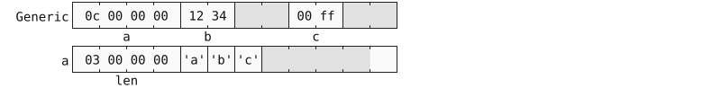

## Metadata

```gramex
let metadata = '#' name:ident ('(' params:list<metavalue> ')')?;
let root_metadata = '#' '!' name:ident ('(' params:list<metavalue> ')')?;
let metavalue = type_spec | value |
	'[' list<metavalue>? ']' |
	'{' list<metavalue ':' metavalue>? '}'
;
```

Metadata is an object-notation-only construct for user-defined extra data.

It is useful for external tooling and is ignored by the parser.

Metadata is declared before items, values, types, fields, variants, and [generic parameters](#generics), using a `#` followed by the metadata name.

Metadata can optionally take metavalue parameters enclosed in parentheses.

Metavalues are values, [type specifiers](#type-specifier), and [lists](#list) and [maps](#map) of them.

Metadata that applies to the whole file is declared before any items, using `#!name`.

#### Example

```structom
#!version("0.1.2")
#!import_rich([uuid])

#doc("user info")
struct User {
	#pattern("[a-zA-Z0-9]+")
	name: str,
	id: #private_constructor
		struct UserId(uuid),
}
```

# Core types

## `none`

The `none` type is a special type that has no value.

It decays to the default value in [optional fields](#definition).

### Object notation

```gramex
let none_type = "none";
let none_value = "none";
```

### Binary encoding

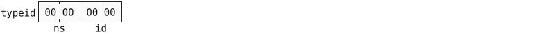

`none` has no value and is 0-aligned.

#### Example

```structom
struct Root {
	field?: u8 = 1,
}
Root { field: none } // identical to Root {} and Root { field: 1 }
```

## `bool`

The `bool` type represents a boolean value: `true` or `false`.

Its default value is `false`.

### Object notation

```gramex
let bool_type = "bool";
let bool_value = "true" | "false";
```

### Binary encoding


**Align and size**: 1 bit.

**Value**: `1` for `true` and `0` for `false`.

#### Example

```structom
do_thing: false,
is_thing: true,
```

## Integers

The integer family consists of signed and unsigned integers of 8, 16, 32, and 64 bits.

They are named `{u/i}n`, where `u` is unsigned, `i` is signed, and `n` is the size in bits.

Their default value is `0`.

### Object notation

```gramex
let bin = '0' | '1';
let dec = '0'..'9';
let hex = '0'..'9' | 'a'..'f' | 'A'..'F';
let nb = "0b" bin ('_'? bin)* |
	"0x" hex ('_'? hex)* |
	dec ('_'? dec)*;
let sign = "-" | "+";

let int_type = "u8" | "u16" | "u32" | "u64" | "i8" | "i16" | "i32" | "i64";
let int_value = sign? nb;
```

Integers are written in decimal, binary (`0b`), or hexadecimal (`0x`).

They take an optional sign and may use `_` to separate digits.

If no type is specified or inferred, the default is `i64`.

### Binary encoding

| Type  | `typeid.id` | Size | Align |
| ----- | ----------- | ---- | ----- |
| `u8`  | `10`        | 1    | 1     |
| `u16` | `11`        | 2    | 2     |
| `u32` | `12`        | 4    | 4     |
| `u64` | `13`        | 8    | 8     |
| `i8`  | `14`        | 1    | 1     |
| `i16` | `15`        | 2    | 2     |
| `i32` | `16`        | 4    | 4     |
| `i64` | `17`        | 8    | 8     |

Integers have a `typeid` with `ns` `0`.

**Value**: a little-endian two's complement integer in `n` bytes.

#### Example

```structom
bare: 123,
signed: -123,
advance: 0x1234_abcd,
specified: u16 123,
```

## Floats

The float family consists of 16-, 32-, and 64-bit [IEEE 754](https://en.wikipedia.org/wiki/IEEE_754) floating-point numbers.

They are named `f16`, `f32`, and `f64` for 16, 32, and 64 bits respectively.

Their default value is `0.0`.

### Object notation

```gramex
let dec_part = dec ('_' dec)*;
let float_expr = ('e' | 'E') sign? dec_part;
let float_nb = sign? (dec_part? '.' dec_part | dec_part) float_expr?;

let float_type = "f16" | "f32" | "f64";
let float_value = float_nb | sign? "inf" | "nan";
```

Floats are written in decimal digits, in the formats `dec`, `.frac`, or `dec.frac`.

They optionally take a sign and an exponent, and support the `_` separator just like integers.

Floats have special values:

- `inf`: positive infinity
- `+inf`: positive infinity
- `-inf`: negative infinity
- `nan`: not a number

If no type is specified or inferred, the default is `f64`.

### Binary encoding

| Type  | `typeid.id` | Size | Align |
| ----- | ----------- | ---- | ----- |
| `f16` | `1a`        | 2    | 2     |
| `f32` | `18`        | 4    | 4     |
| `f64` | `19`        | 8    | 8     |

Floats have a `typeid` with `ns` `0`.

**Value**: a little-endian IEEE 754 floating-point number in `n` bytes.

#### Example

```structom
dec: 123.456,
frac: .123,
full: -123.456e+7,
special: [inf, -inf, nan],
```

## `any`

The `any` type accepts a value of any type.

`any` is the medium of schemaless data.

Its default value is `none`.

### Object notation

```gramex
let any_type = "any";
let any_value = value;
```

### Binary encoding


`any` is encoded as a pointer to an object that encodes the `value` together with its `typeid`, in addition to a `u32` `len` field scaled by 4.

The `value` does not encode its `len` field.

#### Example

```structom
struct Element {
	tag: str,
	attrs: map<str, any>,
}
Element {
	tag: "button",
	attrs: { "disabled": true, "color": "red" },
}
```

## `far`

The `far` type is a pointer to an object in any segment.

`far` is used in large files (> `16GB`), where a single segment is not enough.

Its default value is a null pointer.

### Object notation

```gramex
let far_type = "far" '<' T:type_spec '>';
let far_value = value;
```

`far` has no effect on the object notation.

### Binary encoding


**Align**: 4

`far` is encoded as a fat pointer consisting of the `segment` id and an `u32` scaled `offset` from the beginning of that segment.

A null `far` pointer has both its `segment` and `offset` set to `0`.

# Items

Items are schema constructs that define composite data structures with concrete members.

They are product types ([structs](#structs)) and sum types ([unions](#unions)) with rich semantics: [generics](#generics), [tagging](#tagged-struct), [trees](#tree-struct), [anonymous items](#inner-definitions), [fixed items](#fixed-struct), [rich notation](#rich-types), and more.

Each item gets its own `0`-indexed id based on its order in the file, and can specify its own using `#id`,

ids doesnt continue after specifed ones unless no previous one is left.

A single file can contain at most `65536 (2^16)` items.

Items named `_` are skipped, but their ids are still counted.

### Inner definitions

```gramex
let inner_def = ('#' id:nb)? (
	"fixed"? "struct" name?:ident struct_body |
	"union" name?:ident union_body
);
```

Items can be declared inline within the fields of other items, becoming the types of those fields.

They can be anonymous (no name given), and they inherit the [`fixed`](#fixed-struct) modifier and the [generics](#generics) of their parent item.

They receive the ids directly after their parent's id, in declaration order, and this carries over to nested definitions.

Inner definitions can also be used inside generic parameters.

#### Example

```structom
#0 fixed struct Element {
	tag: str,
	attr: list<#1 struct {
		name: #3 struct AttrName(str),
		value: any,
	}>,
	children: list<Element>,
}

struct _ {}

#5 union Union<T> {
	A, B, C,
	D(/* id = 5 */ union { A, B, C(T) }),
	E { v?: list<T> },
}
```

## Structs

Structs are product data types composed of a fixed set of well-defined members called fields.

Structs translate to structs, objects, maps, tables, records, and similar constructs in other languages.

A struct's default value is a null pointer, or the default value of all its fields if it is [fixed](#fixed-struct) or [tagged](#tagged-struct).

Structs can be nested inside themselves, except for [fixed](#fixed-struct) ones which can not directly contain themself.

#### Example

```structom
struct Struct {
	a: str,
	b: u16,
	c: list<u8>,
}

Struct {
	a: "abc",
	b: 123,
	c: 0x"01 02 03",
}
```

### Definition

```gramex
let struct_def = "fixed"? "struct" name:ident generic_params? struct_body;
let struct_body = '(' inner:type_spec ')' | '{' list<field_def>? '}';

let field_def = ('#' tag:nb)? name:ident '?'? ':' type:type_spec ('=' default:value)?;
```

Structs are defined by a struct definition.

A struct definition consists of the struct `name` followed by its fields inside a body.

Generally, the struct body is a list of field definitions inside a curly block.

Each field definition is composed of a name and a [type specifier](#type-specifier). A field can be made optional with `?`.

If an optional field is not specified, it takes the default value of its type, unless a default value is provided with `= value`.

Each field has its own `0` based tag according to its decleration order, it can specify its own tag using `#tag`.

tags doesnt continue after specifed ones unless no previous one is left, no space in tags is allowed.

Fields named `_` are skipped, but their place in the binary encoding is reserved.

A struct can have zero fields, can have [generic parameters](#generics) after its name, and can be [defined inline](#inner-definitions) within the field of another item.

#### Example

```structom
struct Struct {
	a: str,
	b: u16,
	#3 c?: list<Struct>,
	d?: struct { min: f64, max: f64 },
}
```

### Object value

```gramex
let struct_value = fields_value | tree_value | tagged_inner:value;
let fields_value = '{' fields:list<field_value>? '}';
let field_value = name:ident ':' value;
```

Structs are represented by a list of fields and their values inside a curly block.

Unkown fields are an error.

The type specifier can be omitted if it can be inferred.

#### Example

```structom
Struct {
	a: "abc",
	b: 123,
	c: [
		{ a: "a2", b: 123 },
	],
	d: { min: 0.0, max: 1.0 },
}
```

### Binary encoding

Structs are encoded as a pointer to an object containing the struct's fields.

The object starts with a `u32` length field scaled by 4 bytes, followed by the fields, which are allocated as follows:

- Fields are allocated in definition order. Each field takes the first padding, in ascending order, that can hold it at its natural alignment.
- If none fits, the field is allocated at the end, aligned.

```
field_loop: for field in fields {
	for pad in padding {
		let offset = pad.start.align_to(field.align)
		if offset + field.size <= pad.end {
			padding.split(pad, at: offset, size: field.size)
			allocate(field, at: offset)
			continue field_loop
		}
	}
	let offset = end.align_to(field.align)
	if offset != end { padding.insert(start: end, end: offset) }
	allocate(field, at: offset)
}
```

Bit fields ([`bool`](#bool)s) are allocated together as `u8` fields. They fill bits `0` through `7`, and then a new byte is allocated.

Optional fields that are not non fixed structs allocate an additional bit field after them. If it is `1`, a value is given inside the field. Otherwise, the default value is used.

Unspecified optional pointer fields are encoded as null pointers.

A struct can have at most `65536 (2^16)` fields, spanning at most `16GB (2^34 - 1)` bytes.

#### Example

```structom
struct Struct {
	a: u32,
	b: u8,
	c: u64,
	d: u16,
	e?: u16,
	f: bool,
	g: u8,
}
```

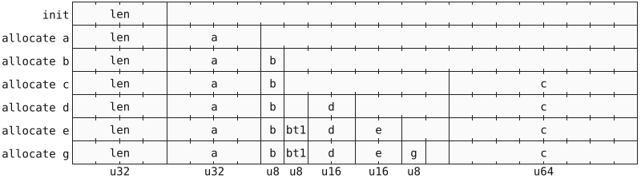

**bt1**: single bit fields ([bools](#bool) and optional flags)


### Fixed struct

A struct with the `fixed` modifier is encoded inline in its parent struct.

A fixed struct is encoded as one big field containing all its fields, using the regular struct encoding without the `len` field.

This big field is aligned to the maximum alignment of its fields and is sized to fit them all.

Fixed structs are frozen in time and cannot evolve. They are subject to the same limits as regular structs.

#### Example

```structom
// align: 4, size: 10
struct Parent {
	a: u16,
	b: Fixed,
	c: u16,
}
// align: 4, size: 6
fixed struct Fixed {
	a: u32,
	b: u16,
}
```


### Tagged struct

Tagged structs are structs that wrap a value.

In a definition, the body of a tagged struct is the wrapped inner type inside parentheses.

In the object notation, a tagged struct value is its type specifier followed by the value of its inner type.

The inner value is written without a type specifier, even when tagged structs are nested.

Tagged structs are transparent in the binary encoding, their encoding is the encoding of their inner type.

#### Example

```structom
struct A(u32)
struct B<T>(T)

[A 123, B<A> 456]
```


### Tree struct

```gramex
let tree_value = fields_value? '[' children:list<value>? ']';
```

Tree structs are object notation sugar for structs with a tree-like shape.

A struct is tree-like if it has a `children` field whose type is an `arr`, a `list`, or a tagged struct wrapping one of them.

A bracket-enclosed list of values can be provided after the fields block as the value of the `children` field. In that case, the fields block becomes optional.

#### Example

```structom
struct Node {
	tag: str = "node",
	attrs?: map<str, any>,
	children?: list<Node>,
}

Node {
	tag: "a",
	attrs: { "id": "a1" },
} [
	Node { tag: "b" },
	Node [ Node {}, Node { tag: 'c' } ],
]
```

## Unions

Unions are sum data types that can be one of multiple variants.

Each variant has its own tag, based on its declaration order, and can be one of several kinds:

- **Unit variant**: a unit value with no fields.
- **Fielded variant**: a variant with its own fields, just like a [struct](#structs).
- **Tagged variant**: a variant wrapping a value.

Unions translate to tagged unions, discriminated unions, enumerations, and similar constructs in other languages.

A union does not have a default value.

#### Example

```structom
union Union {
	A, B, C,
	D(u32),
	F {
		a: u32,
		b?: u32,
	},
}

list<Union> [
	Union.A, .B,
	.D 123,
	.F { a: 123 },
]
```

### Definition

```gramex
let union_def = "fixed"? "union" name:ident generic_params? union_body;
let union_body = union_tag? '{' list<variant> '}';
let union_tag = '(' ("u8" | "u16" | "u32") ')';
let variant = ('#' tag:nb)? "fixed"? name:ident struct_body?;
```

Unions are defined by a union definition.

A union definition consists of the union `name` followed by its list of variants enclosed in a curly block.

Each variant is defined by an identifier, optionally followed by a [struct body](#definition), and can be prefixed with the `fixed` modifier.

Variants named `_` are skipped, but their tags are still counted.

Each variant gets its own `0` based tag based on its declaration order, it can specify its own using `#tag`, ids continue counting after it.

A union can define its tag type inside parentheses after the name.

The tag can be `u8`, `u16`, or `u32`. If it is not specified, the smallest type sufficient for all variants is used.

Unions can have [generic parameters](#generics) after their name and can be [defined inline](#inner-definitions) within the field of another item.

#### Example

```structom
union Union<T>(u16) {
	A, B, C, _,
	D(union { A, B, C(T) }),
	fixed E {
		name: str,
		children: list<Union<T>>,
	},
}
```

### Object value

```gramex
let union_value = '.' variant:ident struct_value?;
```

A union value is a dot followed by the variant name, and then a [struct value](#object-value) if the variant is fielded or tagged.

Variants support all the syntax of structs.

The [type specifier](#type-specifier) can be omitted if the union can be inferred.

#### Example

```structom
list<Union<str>> [
	Union.A, .B,
	.D .C "abc",
	.E { name: "e1" } [
		.C,
		.E { name: "e2" },
	],
]
```

### Binary encoding

Unions are encoded as a `tag` field of the defined tag type, which specifies the variant, followed by a shared space whose encoding changes with each variant.

Depending on the variant kind, this space is:

- **Unit variants**: empty.
- **Tagged variants**: the encoding of the inner type.
- **Non-fixed fielded variants**: a pointer to a [struct object](#binary-encoding-8) containing the variant's fields.
- **Fixed fielded variants**: a [fixed struct](#fixed-struct) containing the variant's fields.

The size of the shared space is the size of the largest variant encoding.

The union's alignment is the maximum of the alignments of all variant fields and of the `tag`.

Unions are subject to the same limits as structs.

#### Example

```structom
// align: 4, size: 8
union Union {
	A, _,
	B(u16),
	C { a: u64, b: i16 },
	fixed D {
		c: u32,
		d?: u16,
	},
}
```

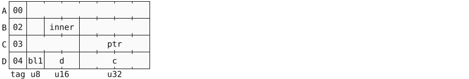


# Collection types

## `arr`

The `arr` type represents a homogeneous, ordered, fixed-size collection of values.

Its default value is an `arr` of the default value of the item type.

### Object notation

```gramex
let arr_type = "arr" '<' item:type_spec ',' size:nb '>';
let arr_value = '[' list<value>? ']';
```

The `arr` [type specifier](#type-specifier) takes 2 generic arguments: the `item` type specifier and the `size` of the `arr`.

`size` can be at most `65535 (2^16 -1)` and can not be zero.

Its value is a list of `size` values enclosed in brackets.

#### Byte literal

```gramex
let byte_literal = "0x" '"' (ws hex[2])* ws '"';
```

The byte literal is a list of whitespace-separated hex bytes. It is transformed into an `arr<u8, N>` or a `list<u8>`.

```structom
0x"01 23 45 67 89 ab cd ef"
```

### Binary encoding

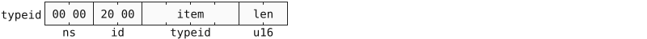


The `arr` typeid takes an additional `item` `typeid` and a `u16` `len` parameter.

An `arr` is encoded as a sequence of `len` `item` fields, each aligned to its natural alignment, with padding if needed.

The `arr` itself is aligned to the `item` alignment.

#### Example

```structom
fixed struct A { a: u16, b: u8 }
arr<A, 2> [A { a: 1, b: 2 }, A { a: 3, b: 4 }]
```

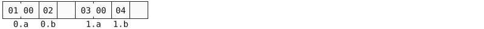

## `list`

The `list` type represents a homogeneous, ordered, variable-size collection of values.

Its default value is the empty list.

A `list` can contain at most `4.2 billion (2^32 -1)` items, spanning at most `16GB (2^34 -1)` bytes.

### Object notation

```gramex
let list_type = "list" '<' item:type_spec '>';
let list_value = '[' list<value>? ']';
```

The `list` type specifier takes the `item` type specifier.

Its value is a list of values enclosed in brackets.

If no type is specified or inferred, the default is `list<any>`.

### Binary encoding

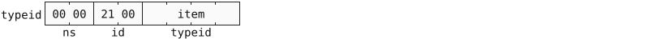


The `list` typeid takes an additional `item` `typeid` parameter.

A `list` is encoded as a pointer to an object containing a `u32` `len` field followed by a sequence of `len` aligned `item` fields.

If the length is zero, the pointer is null.

#### Example

```structom
fixed struct A { a: u16, b: u8 }
list<A> [A { a: 1, b: 2 }, A { a: 3, b: 4 }]
```

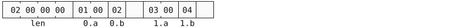

## `str`

The `str` type represents a [UTF-8](https://en.wikipedia.org/wiki/UTF-8) string.

Its default value is the empty string.

A `str` can be at most `4.2 billion (2^32 -1)` bytes long.

### Object notation

```gramex
let str_type = "str";
let str_value = '"' (escape_code | !('"' | '\\'))* '"';
let escape_code = '\\' (
	'\\' | '"' | 'n' | 't' | 'r' |
	'u' '{' hex ('_'? hex)[0..5] '}'
);
```

A `str` value is a sequence of characters and escape codes enclosed in double quotes.

The escape codes are:

- `\\`: backslash (`\`).
- `\"`: double quote (`"`).
- `\n`: newline (`\n`).
- `\t`: horizontal tab (`\t`).
- `\r`: carriage return (`\r`).
- `\u{xxx}`: a Unicode [code point](https://en.wikipedia.org/wiki/Code_point) given as 1 to 6 hex digits `xxx`, optionally separated by underscores.

### Binary encoding


`str` uses the `list<u8>` encoding, where the string is stored as a list of UTF-8 bytes.

#### Example

```structom
"abc \n\"\\ \u{12_34}"
```

## `map`

The `map` type represents an unordered, keyed, variable-size collection of values.

Its default value is an empty `map`.

A `map` can contain at most `4.2 billion (2^32 -1)` items, spanning at most `16GB (2^34 -1)` bytes.

Keys are compared for equality and ordering based on their types:

- **`bool`**: `false` < `true`.
- **Integers**: by their numeric values.
- **Floats**: by the IEEE 754 [total order](https://en.wikipedia.org/wiki/IEEE_754#Total-ordering_predicate), `nan` keys are not allowed.
- **`list`, `arr`**: by their items, in [lexicographic order](https://en.wikipedia.org/wiki/Lexicographic_order).
- **`str`**: as a `list<u8>`.
- **`map`**: as a `list<(key, value)>` sorted by `key`.
- **Structs**: by their fields, in declaration order.
- **Unions**: by their tags, then by their fields in declaration order.
- **`any`**: by their typeid (base, then parameters, `ns`, then `id`), then by their values.
- **`far`**: by the value it points to.
- **Rich types**: as their raw values. Values using unsupported syntax are placed last, in any order.

### Object notation

```gramex
let map_type = "map" '<' key:type_spec ',' value:type_spec '>';
let map_value = '{' list<key:value ':' value>? '}';
```

The `map` [type specifier](#type-specifier) takes 2 generic arguments: the `key` and the `value` type specifiers.

Its value is a list of `:`-separated key-value pairs enclosed in a curly block.

If no type is specified or inferred, the default is `map<any, any>`.

### Binary encoding

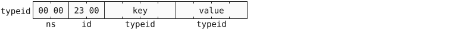


The `map` typeid takes additional `key` and `value` `typeid` parameters.

A `map` is encoded as a pointer to an object containing a `u32` `len` field followed by a sequence of `len` aligned `key` then `value` fields, sorted by `key`.

If the length is zero, the pointer is null.

#### Example

```structom
fixed struct A {
	a: u8,
	b: bool,
}
map<A, f32> {
	A { a: 1, b: true }: 0.5,
	A { a: 1, b: false }: 1,
	A { a: 3, b: true }: 1.5,
}
```

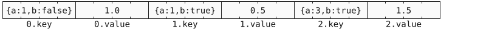

# Rich types

Rich types are types that have two forms:

- **Raw value**: the base value in declarations, object values, and the binary encoding.
- **Rich notation**: additional object value forms for parsers that support them.

Rich notations are optional. Parsers that support them can use them to provide a richer user experience, while parsers that do not should dump them as-is.

`import_rich` is a top-level [metadata](#metadata) that declares, as a `list` of type specifiers, the built-in rich types used inside the file.

`rich` is an item-level metadata that marks an item as a rich type. If a mismatching value syntax is provided, the value is dumped instead of raising an error.

#### Example

```structom
#!import_rich([uuid, inst])

#rich #bitfield({ a: 3, b: 2, c: 3 })
struct BitField(u8)

{
	a: uuid "01234567-1234-1234-1234-123456789abc",
	b: inst "2000-01-01T00:00:00Z",
	c: BitField { a: 0b101, b: 0b10, c: 0b101 },
}
```

## `inst`

```structom
fixed struct inst {
	secs: i64,
	nanos: u32,
}
```


The `inst` type represents an instant in time, measured in nanoseconds since the [Unix epoch](https://en.wikipedia.org/wiki/Unix_time) (`1970-01-01T00:00:00Z`) in the [UTC](https://en.wikipedia.org/wiki/Coordinated_Universal_Time) time zone.

`inst` is composed in its raw form of 2 fields: `secs` seconds plus `nanos` nanoseconds since the Unix epoch.

`inst` has a rich notation of an [RFC 3339](https://datatracker.ietf.org/doc/html/rfc3339) date string, normalized to UTC.

#### Example

```structom
inst "2000-01-01T00:00:00.123456789Z"
inst "2000-01-01 00:00:00.123456789Z"
inst { secs: 946684800, nanos: 123456789 }
```

## `dur`

```structom
fixed struct dur {
	secs: i64,
	nanos: u32,
}
```


The `dur` type represents a duration of time in nanoseconds.

`dur` is composed in its raw form of 2 fields: `secs` seconds plus `nanos` nanoseconds.

`dur` has a rich notation of a [unit field](#unitfield) string of time units with the following properties.

```structom
{
	// non-leap year = 365 days
	["y", "yr", "year"]: { mult: 31_536_000_000_000_000 },
	// 24 hours
	["d", "day"]: { mult: 86_400_000_000_000, max: 364 },
	["h", "hr", "hour"]: { mult: 3_600_000_000_000, max: 23 },
	["m", "min", "minute"]: { mult: 60_000_000_000, max: 59 },
	["s", "sec", "second"]: { mult: 1_000_000_000, max: 59 },
	["ms", "milli", "millisecond"]: { mult: 1_000_000, max: 999 },
	["us", "micro", "microsecond"]: { mult: 1000, max: 999 },
	["ns", "nano", "nanosecond"]: { mult: 1, max: 999 },
}
```

#### Example

```structom
dur "1234.5678s"
dur "20m 34s 567ms 800us"
dur "20min 34sec 567milli 800micro 0nano"
dur { secs: 1234, nanos: 567800000 }
```

## `bint`

```structom
struct bint(list<u8>)
```


The `bint` type represents an arbitrary-precision signed integer.

`bint` is composed in its raw form of a list of bytes in little-endian, minimal-length two's complement format, with a hard limit of `2^32 -1` bytes.

`bint` has a rich notation of a number string with the same format as integers.

#### Example

```structom
bint "36893488147419103231"
bint "+0x1_ff_ff_ff_ff_ff_ff_ff_ff"
bint 0x"ff ff ff ff ff ff ff ff 01"
```

## `dec`

```structom
fixed struct dec {
	exp: i32,
	mant: bint,
}
```


The `dec` type represents an arbitrary-precision decimal number with an exact value.

`dec` is composed in its raw form of an `i32` exponent `exp` and a `bint` [mantissa](https://en.wikipedia.org/wiki/Significand) `mant` that is not divisible by `10`.

`0` `dec` is both `mant` and `exp` `0`.

`dec` has a rich notation of a number string with the same format as floats, without the special values.

#### Example

```structom
dec "3.1415"
dec "+31415e-4"
dec { exp: -4, mant: bint 0x"b7 7a" }
```

## `uuid`

```structom
struct uuid(arr<u8, 16>)
```


The `uuid` type represents a 128-bit globally unique identifier, as defined by [RFC 9562](https://datatracker.ietf.org/doc/html/rfc9562).

`uuid` is composed in its raw form of 16 big-endian bytes.

`uuid` has a rich notation of a UUID string of the form `xxxxxxxx-xxxx-xxxx-xxxx-xxxxxxxxxxxx`, where `x` is a hex digit.

```gramex
let uuid_str = hex[8] '-' hex[4] '-' hex[4] '-' hex[4] '-' hex[12];
```

#### Example

```structom
uuid "01234567-0123-0123-0123-0123456789ab"
uuid 0x"01 23 45 67 01 23 01 23 01 23 01 23 45 67 89 ab"
```

## `color`

```structom
fixed struct color {
	r: u8,
	g: u8,
	b: u8,
	a: u8,
}
```


The `color` type represents an [RGBA](https://en.wikipedia.org/wiki/RGBA_color_model) color.

`color` is composed in its raw form of red, green, blue, and alpha `u8` components.

`color` has a rich notation of a hex color string of the form `#rrggbbaa`, where `r`, `g`, `b`, and the optional `a` are hex digits.

```gramex
let color_str = '#' (red = hex[2]) (green = hex[2]) (blue = hex[2]) (alpha? = hex[2]);
```

#### Example

```structom
color "#ff0000"
color "#ff0000ff"
color { r: 255, g: 0, b: 0, a: 255 }
```

## `bitfield`

`bitfield` is a [metadata](#metadata) that defines a bit field rich notation for an item.

It can be attached to [structs](#tagged-struct) and [variants](#unions) that tag `u8`, `u16`, `u32`, `u64`, or `arr<u8>`. It can also be attached to [unions](#unions) whose variants are all unit variants, in which case it specifies their `size`.

`bitfield` takes an optional integer `size` parameter for the size of the bit field, which by default is the whole container.

It also takes the layout as a `map<ident, int | type_spec>` of field identifiers and their types, which can be:

- `bool` for 1-bit fields.
- Raw fields, with the bit size given by an integer literal.
- Nested bit fields, specified by a type specifier.
- Unions whose variants are all unit variants, specified by a type specifier and encoded as a tag field.

Fields are allocated in declaration order, starting from the least significant bit.

Fields named `_` are skipped, but their place is reserved.

Items with a `bitfield` accept as their rich notation a `map` of the defined fields and their values.

#### Example

```structom
#bitfield(2)
fixed union Union {
	A, B, C, D,
}

#bitfield(2, { a: bool, b: bool })
struct Inner(u8)

#bitfield({
	a: Union,
	b: Inner,
	c: 4,
})
struct Struct(u8)

// same as Struct 0b1010_11_01
Struct {
	a: .B,
	b: { a: true, b: true },
	c: 0b1010,
}
```

## `unitfield`

`unitfield` is a [metadata](#metadata) that defines a unit field string as the rich notation of an item.

A unit field is a string of a series of numbers, each followed by a unit. The resulting value is the sum of all the numbers multiplied by the multipliers of their units.

`unitfield` can be attached to [structs](#tagged-struct) and [variants](#unions) that tag [integers](#integers), [floats](#floats), [`bint`](#bint), or [`dec`](#dec).

### Parameters

`unitfield` takes a `map<str | str[], { min?: value, max?: value, mult: value }>` parameter that specifies the units and their properties.

Units have the following properties:

- **name**: either one `str` name or an `arr<str>` of names.
- **mult**: the unit multiplier.
- **min**: an optional inclusive lower bound.
- **max**: an optional inclusive upper bound.

### Value

```gramex
let unitfield_str = '-'? ((int_value | float_value) unit:ident)+ | '0';
```

The series can contain any number of numbers. Each unit may appear at most once, a number is bounded if it is not the first, and the numbers must follow the units' declaration order.

The result can be negated with a leading `-`, and can be zero if just the literal `0` is passed and no lower bound is specified.

Integer unit fields can use float numbers as long as the resulting product is a whole integer.

Whitespace between the numbers is ignored.

#### Example

```structom
#unitfield({
	["GB", "gb"]: { mult: 1_073_741_824 },
	["MB", "mb"]: { mult: 1_048_576, max: 1023 },
	["KB", "kb"]: { mult: 1_024, max: 1023 },
	["B", "b"]: { mult: 1, max: 1023 },
})
struct Bytes(u64)
[
	Bytes "1.5MB",
	Bytes "1mb 512kb",
	Bytes "1536kb0b",
	Bytes 1572864,
]
```

# Appendix

## Standard metadata

Below is a list of common [metadata](#metadata). They are entirely optional and commonly used.

**`doc`**: on files, items, fields, and variants. Accepts a documentation string.

**`version`**: on files. Accepts a string with the version of the schema.

**`author`**: on files. Accepts a string describing the author of the file.

**`license`**: on files. Accepts a string with the license of the file.

**`deprecated`**: on items, fields, and variants. Marks the target as deprecated and not recommended for use.

**`hidden`**: on items, fields, and variants. Marks the target as hidden, so it is generally not shown.

**`class`**: defines classes for items. It can be used on:

- The root: accepts a class string and a list of type specifiers of the types belonging to the class.
- Items: accepts a class string and marks the item as belonging to that class.
- `any`: accepts a class string and restricts the `any` to values of types belonging to that class.

**`label`**: on items, fields, and variants. Accepts a human-readable label shown in tooling and UIs.

**`default`**: on items. Accepts a value to use as the default for the item.

**`range`**: on types. Accepts 2 value parameters, `min` and `max`, that specify inclusive lower and upper limits for the type. `none` means unbounded.

**`multiple_of`**: on types. Accepts a value that the type must be a multiple of.

**`len_range`**: on types. Accepts 2 value parameters, `min` and `max`, that specify inclusive lower and upper limits for the length of the type. `none` means unbounded.

**`unique_items`**: on types. Marks the type as accepting only unique items.

**`sorted`**: on types. Marks the type as accepting only sorted items.

**`prefer_fmt`**: on types. Hints at the preferred format for the type.

**`regex_pat`**: on `str`. Accepts only values matching the given [regular expression](https://en.wikipedia.org/wiki/Regular_expression).

**`grammar_pat`**: on `str`. Accepts only values matching the given [gramex](https://docs.rs/gramex/latest/gramex/gram_ref/) grammar expression.

**`semver`**: on `str`. Accepts only [semantic version](https://semver.org) strings.

**`url`**: on `str`. Accepts only [URL](https://url.spec.whatwg.org/) strings.

**`path`**: on `str`. Hints that the value is a file-system path, and optionally accepts a `str` with the base path, relative to the directory of the value file.

## Evolution guide

Bidirectional compatibility is a key feature of Structom: readers can read values generated from any version of the schema.

This section describes the evolution guidelines for the binary encoding. The object notation is inherently more resilient.

In general, readers should fail safely on missing fields, and writers must write all padding as zero.

Metadata can be changed in any way. Items, fields, and variants can be renamed if object notation stability is not important.

File paths must remain stable and item id order must be preserved. Items must be deprecated instead of removed.

For structs, field tag order must be preserved. Fields must be added with a tag after the last, and deprecated instead of removed.

Fields cannot change their types or optionality, but they can change their default values, writers must always write all specified values even if they are the default.

Reserved fields can be repurposed if they were not used before.

Fixed structs and tagged structs are frozen in time and cannot change.

Variants can be added to unions as long as the tag capacity is not exhausted, the tag order of existing variants is preserved, and the variant's encoding fits inside the union's.

Non-unit variants are subject to the same guidelines as their struct counterparts.

```structom
// original: file_a.stomd
struct Struct1 {
	a: i32,
	b: u32,
	c: bool,
}

fixed struct Struct2 {
	a: i32,
	b: u32,
}

union Union(u8) {
	A,
	B(i64),
	C {
		_: i32,
		b: u32,
	},
}
```

```structom
// unsafe evolution: file_b.stomd
struct RenamedStruct1 {
	a2: i32,
	b: bool,
	d: i32,
	c?: bool,
}

union Union(u8) {
	A,
	B(arr<u8, 16>),
	D,
	C {
		a: bool,
		b: u32,
	},
	// ...
	V257,
}

fixed struct Struct2 {
	a: i32,
}
```

```structom
// safe evolution: file_a.stomd
struct Struct1 {
	a: i32,
	_: u32,
	#3 d?: u32,
	c: bool,
}

#3 union Union2(u8) {
	A, B, C, D,
}

fixed struct Struct2 {
	a: i32,
	b: u32,
}

union Union(u8) {
	A,
	B(i64),
	C {
		a: i32,
		b: u32,
		c: bool,
	},
	D(u32),
}
```

## File extensions

- `.stomd`: declaration file.
- `.stomo`: object value file.
- `.stomb`: binary value file.

Object notation files are always UTF-8 encoded.

Binary files start with `STOM` (`53 54 4F 4D`) magic number.

## Typeid map

#### `ns` = `0`, `id.high_byte` = `0`

| `row_col` | `0`               | `1`                | `2`                | `3`                | `4`               | `5`                | `6`                | `7`                | `8`              | `9`              | `a`              | `b` | `c` | `d` | `e` | `f` |
| --------- | ----------------- | ------------------ | ------------------ | ------------------ | ----------------- | ------------------ | ------------------ | ------------------ | ---------------- | ---------------- | ---------------- | --- | --- | --- | --- | --- |
| `0`       | [`none`](#none)   | [`any`](#any)      | [`bool`](#bool)    | [`far`](#far)      |                   |                    |                    |                    |                  |                  |                  |     |     |     |     |     |
| `1`       | [`u8`](#integers) | [`u16`](#integers) | [`u32`](#integers) | [`u64`](#integers) | [`i8`](#integers) | [`i16`](#integers) | [`i32`](#integers) | [`i64`](#integers) | [`f32`](#floats) | [`f64`](#floats) | [`f16`](#floats) |     |     |     |     |     |
| `2`       | [`arr`](#arr)     | [`list`](#list)    | [`str`](#str)      | [`map`](#map)      |                   |                    |                    |                    |                  |                  |                  |     |     |     |     |     |
| `3`       |                   |                    |                    |                    |                   |                    |                    |                    |                  |                  |                  |     |     |     |     |     |
| `4`       |                   |                    |                    |                    |                   |                    |                    |                    |                  |                  |                  |     |     |     |     |     |
| `5`       |                   |                    |                    |                    |                   |                    |                    |                    |                  |                  |                  |     |     |     |     |     |
| `6`       |                   |                    |                    |                    |                   |                    |                    |                    |                  |                  |                  |     |     |     |     |     |
| `7`       |                   |                    |                    |                    |                   |                    |                    |                    |                  |                  |                  |     |     |     |     |     |
| `8`       | [`inst`](#inst)   | [`dur`](#dur)      | [`bint`](#bint)    | [`dec`](#dec)      | [`uuid`](#uuid)   | [`color`](#color)  |                    |                    |                  |                  |                  |     |     |     |     |     |
| `9`       |                   |                    |                    |                    |                   |                    |                    |                    |                  |                  |                  |     |     |     |     |     |
| `a`       |                   |                    |                    |                    |                   |                    |                    |                    |                  |                  |                  |     |     |     |     |     |
| `b`       |                   |                    |                    |                    |                   |                    |                    |                    |                  |                  |                  |     |     |     |     |     |
| `c`       |                   |                    |                    |                    |                   |                    |                    |                    |                  |                  |                  |     |     |     |     |     |
| `d`       |                   |                    |                    |                    |                   |                    |                    |                    |                  |                  |                  |     |     |     |     |     |
| `e`       |                   |                    |                    |                    |                   |                    |                    |                    |                  |                  |                  |     |     |     |     |     |
| `f`       |                   |                    |                    |                    |                   |                    |                    |                    |                  |                  |                  |     |     |     |     |     |
